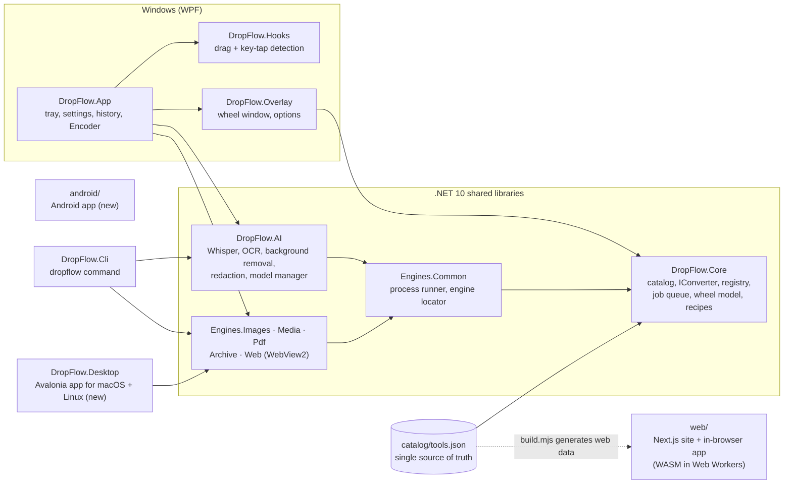

<div dir="rtl">

<p align="center">
  
</p>

<h1 align="center">DropFlow</h1>

<p align="center">
  <strong>اسحب الملف، اضغط مفتاحاً، وأفلته على العجلة. يتحوّل على جهازك ولا يُرفع إلى أي مكان.</strong><br>
  ويندوز · ماك · لينكس · أندرويد · الويب، بواجهة عربية كاملة (من اليمين لليسار) وإنجليزية
</p>

<p align="center">
  <a href="https://github.com/hamwimoustafa88-maker/dropflow/releases/latest"></a>
  <a href="https://github.com/hamwimoustafa88-maker/dropflow/actions/workflows/ci.yml"></a>
  <a href="LICENSE"></a>
  
  <a href="https://wa.me/96170863903"></a>
</p>

<p align="center">
  <a href="https://dropflow.scouthub.dev/ar">الموقع</a> ·
  <a href="https://dropflow.scouthub.dev/ar/app">تطبيق الويب</a> ·
  <a href="#التنزيل">التنزيل</a> ·
  <a href="#البناء-من-المصدر">البناء</a> ·
  <a href="https://dropflow.scouthub.dev/ar/privacy">الخصوصية</a> ·
  <a href="https://dropflow.scouthub.dev/ar/terms">الشروط</a> ·
  <a href="#التواصل">التواصل</a> ·
  <a href="README.md"><strong>English</strong></a>
</p>

<p align="center">
  <a href="https://dropflow.scouthub.dev/ar"></a>
</p>

---

DropFlow محوّل ملفات مجاني ومفتوح المصدر مبني على حركة واحدة: ابدأ بسحب أي ملف، واضغط **Shift** أو **Ctrl** أو **Alt**، فتظهر
عجلة دائرية تحت المؤشر. أفلت الملف على أحد أجزائها فيحوّله DropFlow أو يضغطه أو يعدّله أو يشاركه **على جهازك**، بمحركات مضمّنة
(FFmpeg وqpdf وTesseract) وذكاء اصطناعي محلي. وكتالوج الأدوات نفسه يشغّل تطبيق ويندوز، وتطبيقَي ماك/لينكس وأندرويد الجديدين،
وأداة سطر الأوامر، وتطبيق ويب يعمل داخل المتصفح ودون اتصال.

## التنزيل

كل رابط في الجدول يُنزّل ملف **آخر إصدار** مباشرة
([كل الملفات والبصمات](https://github.com/hamwimoustafa88-maker/dropflow/releases/latest) ·
[`SHA256SUMS.txt`](https://github.com/hamwimoustafa88-maker/dropflow/releases/latest/download/SHA256SUMS.txt)).

| المنصة | الملف | ملاحظات |
|---|---|---|
| **ويندوز 10/11** ‏x64 | [DropFlow-win-Setup.exe](https://github.com/hamwimoustafa88-maker/dropflow/releases/latest/download/DropFlow-win-Setup.exe) | مثبّت مع تحديث تلقائي، ويتضمن FFmpeg وqpdf وTesseract |
| ويندوز ARM64 | [DropFlow-win-arm64-Setup.exe](https://github.com/hamwimoustafa88-maker/dropflow/releases/latest/download/DropFlow-win-arm64-Setup.exe) | جديد |
| ويندوز نسخة محمولة | [DropFlow-win-Portable.zip](https://github.com/hamwimoustafa88-maker/dropflow/releases/latest/download/DropFlow-win-Portable.zip) | دون تثبيت |
| ويندوز سطر الأوامر | [dropflow-cli-win-x64.zip](https://github.com/hamwimoustafa88-maker/dropflow/releases/latest/download/dropflow-cli-win-x64.zip) | `dropflow list / convert / recipe` |
| **ماك** معالجات Apple | [DropFlow-mac-arm64.dmg](https://github.com/hamwimoustafa88-maker/dropflow/releases/latest/download/DropFlow-mac-arm64.dmg) | جديد، غير موثّق لدى Apple (انظر أدناه) |
| ماك Intel | [DropFlow-mac-x64.dmg](https://github.com/hamwimoustafa88-maker/dropflow/releases/latest/download/DropFlow-mac-x64.dmg) | جديد، غير موثّق لدى Apple |
| **لينكس** Ubuntu / Debian | [amd64 ‏.deb](https://github.com/hamwimoustafa88-maker/dropflow/releases/latest/download/DropFlow-linux-amd64.deb) · [arm64 ‏.deb](https://github.com/hamwimoustafa88-maker/dropflow/releases/latest/download/DropFlow-linux-arm64.deb) | جديد |
| لينكس Fedora / openSUSE | [x86_64 ‏.rpm](https://github.com/hamwimoustafa88-maker/dropflow/releases/latest/download/DropFlow-linux-x86_64.rpm) · [aarch64 ‏.rpm](https://github.com/hamwimoustafa88-maker/dropflow/releases/latest/download/DropFlow-linux-aarch64.rpm) | جديد |
| لينكس، أي توزيعة | [x86_64 ‏AppImage](https://github.com/hamwimoustafa88-maker/dropflow/releases/latest/download/DropFlow-linux-x86_64.AppImage) · [aarch64 ‏AppImage](https://github.com/hamwimoustafa88-maker/dropflow/releases/latest/download/DropFlow-linux-aarch64.AppImage) | جديد؛ نفّذ `chmod +x` ثم شغّله |
| **أندرويد** | [DropFlow-android.apk](https://github.com/hamwimoustafa88-maker/dropflow/releases/latest/download/DropFlow-android.apk) | جديد |
| **الويب** | [dropflow.scouthub.dev/ar/app](https://dropflow.scouthub.dev/ar/app) | يعمل داخل المتصفح، ودون اتصال بعد أول زيارة |

النسخ **غير موقّعة رقمياً بعد**، لذلك يحذّر كل نظام مرة واحدة:

- **ويندوز** (SmartScreen): «مزيد من المعلومات» ثم «تشغيل على أي حال» (*More info → Run anyway*). نعمل على التوقيع المجاني عبر SignPath Foundation ([السياسة](docs/code-signing-policy.md)).
- **ماك** (Gatekeeper): زر الفأرة الأيمن على التطبيق ثم «فتح» (أو إعدادات النظام ← الخصوصية والأمان ← «فتح على أي حال»). لا نستخدم توثيق Apple المدفوع ([docs/macos.md](docs/macos.md)).
- **أندرويد**: اسمح بتثبيت التطبيقات من هذا المصدر عند السؤال.

> تطبيق ويندوز هو النسخة المرجعية. أما **نسخ ماك ولينكس وأندرويد فجديدة واختبارها أقل بكثير**؛ نرجو
> [إبلاغنا بأي خلل](https://github.com/hamwimoustafa88-maker/dropflow/issues). والملف الذي لم يُرفع بعد مع آخر إصدار يعطي خطأ 404، ويعرض
> الموقع منصته بعبارة «قريباً».

## كيف يعمل

| المفتاح أثناء السحب | العجلة | أمثلة |
|---|---|---|
| **Shift** | التحويل | PNG → WebP، ‏HEIC → JPG، ‏MKV → MP4، ‏DOCX → PDF، ‏SRT → VTT |
| **Ctrl** | الأدوات | ضغط، تغيير الحجم، قص، دمج PDF وتقسيمه، قص الفيديو، تحويل الكلام إلى نص، OCR، إزالة الخلفية |
| **Alt** | الإجراءات | نسخ، نقل، مشاركة، نسخ المسار، فتح الطرفية، رف عائم، إرسال للهاتف |

تنتهي كل عجلة بزر **«+ إضافة»** لتثبيت أي أداة أخرى عليها لهذا النوع من الملفات، والمفاتيح قابلة للتغيير. ويمكنك أيضاً استخدام
قائمة الزر الأيمن في المستكشف و«إرسال إلى»، ولصق ملف أو رابط بـ **Ctrl+Alt+V**، والمجلدات المراقَبة، والوصفات، أو أتمتة كل شيء
بأداة سطر الأوامر `dropflow`.

## المزايا

الأرقام من [`catalog/tools.json`](catalog/tools.json)، المصدر الوحيد للأدوات الذي تشترك فيه كل التطبيقات (القائمة الكاملة في
[docs/feature-catalog.md](docs/feature-catalog.md)):

<p align="center"><strong><!--n:conversions-->428<!--/n--> تحويلاً · <!--n:tools-->66<!--/n--> أداة · <!--n:actions-->7<!--/n--> إجراءات على الملفات · <!--n:families-->10<!--/n--> عائلات صيغ</strong></p>

| المجال | ما تحصل عليه |
|---|---|
| **الصور** (<!--n:cat.image-->17<!--/n--> أداة) | JPG وPNG وWebP وHEIC وTIFF وAVIF وBMP وGIF وSVG وICO؛ ضغط وتغيير حجم وقص وتدوير وتحرير وتعليق وكولاج وحذف بيانات EXIF/GPS وأيقونات وFavicon ورموز QR |
| **PDF** ‏(<!--n:cat.pdf-->18<!--/n--> أداة) | دمج وتقسيم وترتيب وتدوير وضغط وعلامة مائية وترقيم صفحات واقتصاص وتوقيع مرئي وإخفاء نهائي ومقارنة، وحماية وفتح (بكلمة مرور تعرفها)، وإصلاح وPDF/A-2b، وتحويل PDF إلى Word وPowerPoint وExcel وصور ونص وEPUB |
| **المستندات** | Word والجداول والعروض وMarkdown وHTML وEPUB وCSV/JSON إلى PDF وصور، عبر محرك متصفح مدمج (دون LibreOffice) |
| **الفيديو** (<!--n:cat.video-->15<!--/n-->) و**الصوت** (<!--n:cat.audio-->10<!--/n-->) | تحويل وضغط (حتى إلى حجم مستهدف) وقص واقتصاص وتقسيم ودمج وسرعة وكتم وتوحيد المستوى وصفير وفيديو موجة صوتية ودمج الترجمة، و**مُرمّز DropFlow** ‏(H.264 / H.265 / AV1 مع كرت الشاشة ومسبقات جاهزة) |
| **ذكاء اصطناعي محلي** | تحويل الكلام إلى نص بـ Whisper (يدعم العربية)، وOCR ‏(Tesseract وWindows OCR، عربي وإنجليزي)، وإزالة الخلفية، والإخفاء التلقائي للوجوه والنصوص؛ لا يُنزَّل أي نموذج إلا بعد موافقتك |
| **الأرشيف وأدوات عامة** | فك ZIP وTAR وGZ و7z وRAR بأمان، والضغط إلى ZIP، والبصمات، وBase64، وإعادة التسمية الجماعية |
| **الإجراءات** | نسخ ونقل ومشاركة ونسخ المسار والطرفية والرف العائم والإرسال إلى هاتف على شبكة Wi-Fi نفسها (رمز QR) |

**تطبيق الويب** يشغّل <!--n:web-->36<!--/n--> أداة من الـ <!--n:tools-->66<!--/n--> داخل المتصفح (الصور وPDF والصوت والفيديو عبر ffmpeg.wasm وOCR وإزالة الخلفية والترجمات
والأرشيف والبصمات). أما تحويلات Office وWhisper وبعض الأدوات الأخرى فتحتاج أحد التطبيقات.

## الموقع

[dropflow.scouthub.dev](https://dropflow.scouthub.dev/ar) موقع ثابت وبسيط بلغتين (العربية افتراضياً والإنجليزية، من اليمين لليسار، بلا كوكيز ولا إحصاءات تتبّع):

- **الصفحة الرئيسية**: عجلة تجريبية، وأزرار التنزيل لكل المنصات، وقسم للمبرمجين (خطوات البناء، البلاغات، سياسة الأمان، سياسة توقيع الكود، الرخصة)، وأسئلة شائعة.
- **[تطبيق الويب](https://dropflow.scouthub.dev/ar/app)**: DropFlow داخل المتصفح، ولا يُرفع أي شيء.
- **[سياسة الخصوصية](https://dropflow.scouthub.dev/ar/privacy)** و**[شروط الاستخدام](https://dropflow.scouthub.dev/ar/terms)**: صفحتان بلغة بسيطة، فيهما ملخص «في دقيقة واحدة» وفهرس للأقسام.
- **التواصل**: زر واتساب واحد في تذييل الصفحة وقسم «عن DropFlow» ودعوة التنزيل الأخيرة والصفحتين القانونيتين. وللأعطال والثغرات استخدم [Issues على GitHub](https://github.com/hamwimoustafa88-maker/dropflow/issues) (ولا تنشر ملفات خاصة هناك).

## الخصوصية

الخصوصية هي جوهر المنتج: **محتوى ملفاتك لا يغادر جهازك أبداً.**

- التطبيقات تعمل دون إنترنت، ولا تتصل بالشبكة إلا للبحث عن تحديث في GitHub Releases، وتنزيل نماذج الذكاء الاصطناعي بعد موافقتك،
  وتنزيل ملف من رابط تطلبه أنت، وخادم «إرسال للهاتف» على شبكتك المحلية ما دامت نافذته مفتوحة.
- تطبيق الويب يعالج الملفات داخل المتصفح (Web Workers وWebAssembly)، وسياسة أمان المحتوى (CSP) تمنع الرفع، واختبار آلي يفحص الكود
  بحثاً عن أي اتصال شبكي غير طلب «تنزيل هذا الرابط».
- لا حسابات ولا إحصاءات تتبّع ولا إعلانات. التفاصيل في [سياسة الخصوصية](https://dropflow.scouthub.dev/ar/privacy) و[شروط الاستخدام](https://dropflow.scouthub.dev/ar/terms).

## بنية المشروع

<div dir="ltr">



</div>

قواعد تحفظ الجودة: كل أداة معرّفة مرة واحدة في الكتالوج وتطبّق عقد المحوّل نفسه
([docs/writing-a-converter.md](docs/writing-a-converter.md))، والمحركات الخارجية تعمل كبرامج مستقلة مع مهلة زمنية وإمكانية إلغاء،
والملفات الأصلية لا تُستبدل أبداً (`name (converted).ext`)، والتطبيق لا يعمل بصلاحيات المسؤول. القرارات موثّقة في [docs/adr/](docs/adr/).

## البناء من المصدر

<div dir="ltr">

```bash
git clone https://github.com/hamwimoustafa88-maker/dropflow.git
cd dropflow
node catalog/build.mjs          # validates the catalog, must print OK
```

</div>

المتطلبات: [‎.NET 10 SDK](https://dotnet.microsoft.com/download)، و[Node.js](https://nodejs.org/) ‏20 أو أحدث (يستخدم CI الإصدار 24)، وGit؛
وPowerShell 7 ‏(`pwsh`) لسكربت المحركات؛ وJDK 17 أو أحدث مع Android SDK لنسخة أندرويد.

| الهدف | الأمر |
|---|---|
| تطبيق ويندوز (WPF، ويندوز 10/11) | `dotnet run --project src/DropFlow.App` |
| تطبيق ماك / لينكس (Avalonia) | `dotnet run --project src/DropFlow.Desktop` |
| سطر الأوامر (أي نظام) | `dotnet run --project src/DropFlow.Cli -- list` |
| الويب | `cd web && npm install && npm run dev` ‏(http://localhost:3000) |
| أندرويد | `cd android && ./gradlew assembleDebug` |
| المحركات المضمّنة (FFmpeg وqpdf وTesseract) | `pwsh tools/fetch-engines.ps1` (نسخ مثبّتة يُتحقق من بصمتها، في مجلد `tools/engines` المستثنى من Git) |

تفاصيل التحزيم والإصدار في [docs/release.md](docs/release.md).

## الاختبارات

| المجموعة | الأمر |
|---|---|
| ‎.NET ‏(xUnit، مشروع اختبار لكل مشروع مصدر) | `dotnet test DropFlow.sln` (اختبارات المحركات والنماذج تُتخطّى بشكل ظاهر عند غياب FFmpeg أو qpdf أو Tesseract أو نموذج) |
| اختبارات الويب (Vitest) | `cd web && npm test` |
| فحص الكود وبناء الإنتاج للويب | `npm run lint` · `npm run build` |
| اختبار الويب الشامل (Edge/Chrome دون واجهة عبر DevTools، بملفات حقيقية ومراقبة الشبكة) | `npm run build && npx next start --port 3200` ثم `node e2e/run.mjs http://localhost:3200` |
| أندرويد | `cd android && ./gradlew test` |

ما تم التحقق منه وما لم يُتحقق منه بعد مسجّل في [docs/status.md](docs/status.md) (بالإنجليزية)، فاقرأه قبل الاعتماد على أي ميزة.

## هيكل المستودع

| المسار | المسؤولية |
|---|---|
| `catalog/` | ملف `tools.json` (كل أداة وتحويل) و`build.mjs` (يتحقق منه ويولّد الوثائق وبيانات الموقع) |
| `src/DropFlow.Core` | تحميل الكتالوج، عقد `IConverter`، السجل، طابور المهام، نموذج العجلة، تسمية الملفات الناتجة، الإعدادات، السجل، الوصفات |
| `src/DropFlow.Engines.*` | المحوّلات حسب المجال: `Images` و`Media` و`Pdf` و`Archive` و`Web` ‏(WebView2) و`Common` (تشغيل البرامج المساعدة وإيجادها) |
| `src/DropFlow.AI` | Whisper وOCR وإزالة الخلفية والإخفاء التلقائي ومدير النماذج (مع التحقق بـ SHA-256) |
| `src/DropFlow.Hooks` · `src/DropFlow.Overlay` · `src/DropFlow.App` | ويندوز: مراقبة الإدخال، نافذة العجلة، تطبيق WPF (شريط المهام، الإعدادات، السجل، المُرمّز، التحديثات) |
| `src/DropFlow.Desktop` | تطبيق Avalonia لماك ولينكس (جديد) |
| `src/DropFlow.Cli` | أداة سطر الأوامر `dropflow` |
| `android/` | تطبيق أندرويد (جديد) |
| `web/` | صفحة الهبوط وصفحتا الخصوصية والشروط وتطبيق الويب (Next.js، عربي/إنجليزي) ([web/README.md](web/README.md)) |
| `tests/` | مشاريع xUnit ومولّدات ملفات العيّنات |
| `installer/` · `.github/workflows/` | التحزيم وقوالب winget وسير عمل CI والإصدار |
| `tools/` | سكربتات تجلب المحركات وقت البناء (لا تُرفع الملفات التنفيذية إلى Git) |
| `docs/` | الخطة، سجلات القرارات (ADR)، سجل الحالة، الأعمال المؤجلة، وثائق الإصدار والتوقيع وماك |

## المساهمة

نرحّب بالمساهمات، ونرحّب بالمطوّرين العرب خصوصاً. اقرأ [CONTRIBUTING.md](CONTRIBUTING.md) (فيه قسم بالعربية: الإعداد وقواعد
المشروع وConventional Commits)، ووقّع كل commit وفق [شهادة منشأ المطوّر DCO](https://developercertificate.org/) ‏(`git commit -s`).
ابدأ بالمهام الموسومة [`good first issue`](https://github.com/hamwimoustafa88-maker/dropflow/labels/good%20first%20issue)، وللأسئلة استخدم
[Discussions](https://github.com/hamwimoustafa88-maker/dropflow/discussions) (يمكنك الكتابة بالعربية). التزم بـ [ميثاق السلوك](CODE_OF_CONDUCT.md).

خارطة الطريق: [docs/plan.md](docs/plan.md) · الأعمال المؤجلة: [docs/deferred.md](docs/deferred.md).

## التواصل

[](https://wa.me/96170863903)

للأسئلة والأفكار والشراكات: واتساب. وللأعطال وطلبات الميزات: [Issues على GitHub](https://github.com/hamwimoustafa88-maker/dropflow/issues).

## الأمان

أبلغ عن الثغرات الأمنية بشكل خاص كما في [SECURITY.md](SECURITY.md)، لا في Issues العامة.

## الرخصة والعلامة التجارية

DropFlow برنامج حر وفق **رخصة جنو العمومية العامة (GNU GPL) الإصدار 3 أو (حسب اختيارك) أي إصدار لاحق**
([LICENSE](LICENSE)، [ADR-0013](docs/adr/0013-gpl3-open-source.md)). حقوق النشر (c) 2026 ScoutHub والمساهمون.

- **الاسم والشعار:** رخصة GPL تشمل الكود فقط، لا اسم «DropFlow» ولا شعاره. النسخ المعدّلة يجب أن تحمل اسماً وشعاراً مختلفين؛ راجع [TRADEMARK.md](TRADEMARK.md).
- **المكوّنات الخارجية** تبقى برخصها الخاصة: [THIRD-PARTY-NOTICES.md](THIRD-PARTY-NOTICES.md).
- **FFmpeg** (نسخة برخصة GPL-3.0) يُشحن دون تعديل كبرنامج مستقل في مجلد `engines\` داخل المثبّت، مع رخصته وعرض مكتوب لتوفير
  الكود المصدري؛ الكود متاح على <https://ffmpeg.org/releases/> وعند الطلب عبر Issues في هذا المستودع.

## الفريق والشكر

من تطوير فرق **ScoutHub**، ورئيس فريق التطوير **مصطفى الحموي** (لبنان). للتواصل: انظر [التواصل](#التواصل).

يقوم DropFlow على جهود مشاريع كثيرة، منها: FFmpeg وqpdf وTesseract OCR وMagick.NET ‏(ImageMagick) وPDFsharp وPdfPig وPDFium
وOpen XML SDK وClosedXML وMarkdig وSharpCompress وZXing.Net وWhisper.net ‏(whisper.cpp) وONNX Runtime وVelopack وAvalonia
وCommunityToolkit.Mvvm وH.NotifyIcon وNext.js وReact وTailwind CSS وnext-intl وpdf-lib وpdf.js وffmpeg.wasm وTesseract.js وfflate.
فكرة السحب والعجلة مستوحاة من تطبيق Tangerine للماك؛ وDropFlow مشروع مستقل لا يرتبط به.

</div>
