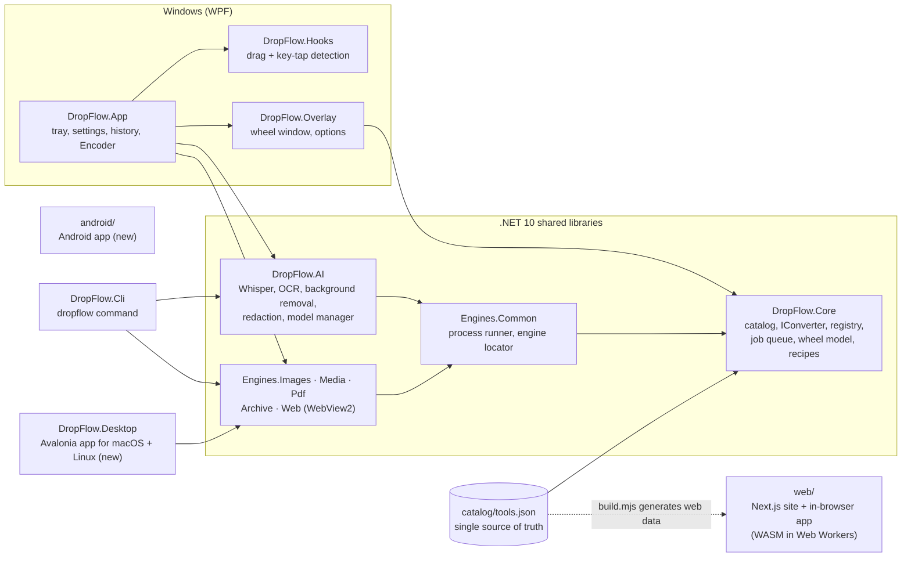

<p align="center">
  
</p>

<h1 align="center">DropFlow</h1>

<p align="center">
  <strong>Drag a file, tap a key, drop it on the wheel. Converted on your device, never uploaded.</strong><br>
  Windows · macOS · Linux · Android · Web, in English and Arabic (full RTL)
</p>

<p align="center">
  <a href="https://github.com/hamwimoustafa88-maker/dropflow/releases/latest"></a>
  <a href="https://github.com/hamwimoustafa88-maker/dropflow/actions/workflows/ci.yml"></a>
  <a href="LICENSE"></a>
  
  <a href="https://wa.me/96170863903"></a>
</p>

<p align="center">
  <a href="https://dropflow.scouthub.dev/en">Website</a> ·
  <a href="https://dropflow.scouthub.dev/en/app">Web app</a> ·
  <a href="#download">Download</a> ·
  <a href="#build-from-source">Build</a> ·
  <a href="https://dropflow.scouthub.dev/en/privacy">Privacy</a> ·
  <a href="https://dropflow.scouthub.dev/en/terms">Terms</a> ·
  <a href="#contact">Contact</a> ·
  <a href="README.ar.md"><strong>اقرأ بالعربية</strong></a>
</p>

<p align="center">
  <a href="https://dropflow.scouthub.dev/en"></a>
</p>

---

DropFlow is a free, open-source file converter built around one gesture: start dragging any file, tap **Shift**, **Ctrl** or
**Alt**, and a radial wheel opens under the cursor. Drop the file on a slice and DropFlow converts, compresses, edits or
shares it **locally**, with bundled engines (FFmpeg, qpdf, Tesseract) and on-device AI. The same catalog of tools powers the
Windows app, the new macOS/Linux and Android apps, a command-line tool and an in-browser web app that works offline.

## Download

Every link below downloads the file of the **latest release** directly
([all files and checksums](https://github.com/hamwimoustafa88-maker/dropflow/releases/latest) ·
[`SHA256SUMS.txt`](https://github.com/hamwimoustafa88-maker/dropflow/releases/latest/download/SHA256SUMS.txt)).

| Platform | File | Notes |
|---|---|---|
| **Windows 10/11** x64 | [DropFlow-win-Setup.exe](https://github.com/hamwimoustafa88-maker/dropflow/releases/latest/download/DropFlow-win-Setup.exe) | Installer with auto-update; FFmpeg, qpdf and Tesseract included |
| Windows ARM64 | [DropFlow-win-arm64-Setup.exe](https://github.com/hamwimoustafa88-maker/dropflow/releases/latest/download/DropFlow-win-arm64-Setup.exe) | New |
| Windows portable | [DropFlow-win-Portable.zip](https://github.com/hamwimoustafa88-maker/dropflow/releases/latest/download/DropFlow-win-Portable.zip) | No installation |
| Windows CLI | [dropflow-cli-win-x64.zip](https://github.com/hamwimoustafa88-maker/dropflow/releases/latest/download/dropflow-cli-win-x64.zip) | `dropflow list / convert / recipe` |
| **macOS** Apple silicon | [DropFlow-mac-arm64.dmg](https://github.com/hamwimoustafa88-maker/dropflow/releases/latest/download/DropFlow-mac-arm64.dmg) | New, not notarized (see below) |
| macOS Intel | [DropFlow-mac-x64.dmg](https://github.com/hamwimoustafa88-maker/dropflow/releases/latest/download/DropFlow-mac-x64.dmg) | New, not notarized |
| **Linux** Ubuntu / Debian | [amd64 .deb](https://github.com/hamwimoustafa88-maker/dropflow/releases/latest/download/DropFlow-linux-amd64.deb) · [arm64 .deb](https://github.com/hamwimoustafa88-maker/dropflow/releases/latest/download/DropFlow-linux-arm64.deb) | New |
| Linux Fedora / openSUSE | [x86_64 .rpm](https://github.com/hamwimoustafa88-maker/dropflow/releases/latest/download/DropFlow-linux-x86_64.rpm) · [aarch64 .rpm](https://github.com/hamwimoustafa88-maker/dropflow/releases/latest/download/DropFlow-linux-aarch64.rpm) | New |
| Linux, any distro | [x86_64 AppImage](https://github.com/hamwimoustafa88-maker/dropflow/releases/latest/download/DropFlow-linux-x86_64.AppImage) · [aarch64 AppImage](https://github.com/hamwimoustafa88-maker/dropflow/releases/latest/download/DropFlow-linux-aarch64.AppImage) | New; `chmod +x` then run |
| **Android** | [DropFlow-android.apk](https://github.com/hamwimoustafa88-maker/dropflow/releases/latest/download/DropFlow-android.apk) | New |
| **Web** | [dropflow.scouthub.dev/en/app](https://dropflow.scouthub.dev/en/app) | Runs in the browser, works offline after the first visit |

The builds are **not code-signed yet**, so each system warns once:

- **Windows** SmartScreen: *More info → Run anyway*. Free signing through SignPath Foundation is being prepared ([policy](docs/code-signing-policy.md)).
- **macOS** Gatekeeper: right-click the app → *Open* (or System Settings → Privacy & Security → *Open Anyway*). There is no paid Apple notarization ([docs/macos.md](docs/macos.md)).
- **Android**: allow installing apps from this source when asked.

> The Windows app is the reference build. The **macOS, Linux and Android builds are new and much less tested**; please
> [report what breaks](https://github.com/hamwimoustafa88-maker/dropflow/issues). A file that is not in the latest release yet
> answers 404; the website shows such platforms as "Soon".

## How it works

| Key while dragging | Wheel | Examples |
|---|---|---|
| **Shift** | Convert | PNG → WebP, HEIC → JPG, MKV → MP4, DOCX → PDF, SRT → VTT |
| **Ctrl** | Tools | compress, resize, crop, merge/split PDF, trim video, speech to text, OCR, remove background |
| **Alt** | Actions | copy, move, share, copy path, open terminal, float on a shelf, send to phone |

Every wheel ends with **+ Add**: pin any other tool to that wheel for that kind of file. Keys are configurable. You can also
right-click in Explorer, use Send To, paste a file or link with **Ctrl+Alt+V**, watch folders, run recipes, or script it all
with the `dropflow` CLI.

## Features

Counts come from [`catalog/tools.json`](catalog/tools.json), the single source of truth shared by every app (full list:
[docs/feature-catalog.md](docs/feature-catalog.md)):

<p align="center"><strong><!--n:conversions-->428<!--/n--> conversions · <!--n:tools-->69<!--/n--> tools · <!--n:actions-->7<!--/n--> file actions · <!--n:families-->10<!--/n--> format families</strong></p>

| Area | What you get |
|---|---|
| **Images** (<!--n:cat.image-->18<!--/n--> tools) | JPG, PNG, WebP, HEIC, TIFF, AVIF, BMP, GIF, SVG, ICO; compress, resize, crop, rotate, edit, annotate, collage, strip EXIF/GPS, icons and favicons, QR codes |
| **PDF** (<!--n:cat.pdf-->19<!--/n--> tools) | merge, split, organize, rotate, compress, watermark, page numbers, crop, visible signature, true redaction, compare, protect / unlock (with a password you know), repair, PDF/A-2b, PDF → Word, PowerPoint, Excel, images, text, EPUB |
| **Documents** | Word, spreadsheets, slides, Markdown, HTML, EPUB, CSV/JSON → PDF and images, through a built-in browser engine (no LibreOffice needed) |
| **Video** (<!--n:cat.video-->15<!--/n-->) and **audio** (<!--n:cat.audio-->10<!--/n-->) | convert, compress (also to a target size), trim, crop, split, join, speed, mute, normalize, bleep, waveform video, burn-in subtitles, and **DropFlow Encoder** (H.264 / H.265 / AV1, GPU encoders, presets) |
| **Local AI** | speech to text with Whisper (Arabic included), OCR (Tesseract + Windows OCR, English and Arabic), background removal, automatic face/text redaction, English and Arabic translation of text, subtitles, PDFs and pictures (Opus-MT); models download only after you agree |
| **Archives and utilities** | extract ZIP / TAR / GZ / 7z / RAR safely, create ZIP, hashes, Base64, batch rename |
| **Actions** | copy, move, share, copy path, terminal, floating shelf, send to a phone on the same Wi-Fi (QR code) |

The **web app** runs <!--n:web-->36<!--/n--> of the <!--n:tools-->69<!--/n--> tools inside the browser (images, PDF, audio/video through ffmpeg.wasm, OCR, background
removal, subtitles, archives, hashes). Office conversions, Whisper and a few desktop-only tools need an app.

## Website

[dropflow.scouthub.dev](https://dropflow.scouthub.dev/en) is a small, static, bilingual site (Arabic by default, English, full RTL; no cookies, no analytics):

- **Home**: the demo wheel, download buttons for every platform, a developer section (build steps, issues, security policy, code-signing policy, licence) and a FAQ.
- **[Web app](https://dropflow.scouthub.dev/en/app)**: DropFlow in the browser, nothing uploaded.
- **[Privacy Policy](https://dropflow.scouthub.dev/en/privacy)** and **[Terms of Use](https://dropflow.scouthub.dev/en/terms)**: plain-language pages with a one-minute summary and a contents list.
- **Contact**: one WhatsApp button in the footer, the About section, the closing call to action and the legal pages. Bugs and security reports go to [GitHub Issues](https://github.com/hamwimoustafa88-maker/dropflow/issues) (please do not post private files there).

## Privacy

Privacy is the product: **file contents never leave your device.**

- The apps work offline. They go online only for an update check against GitHub Releases, AI model downloads you approve, a
  file you ask them to fetch from a link, and the local-network "Send to phone" server while its window is open.
- The web app processes files in Web Workers with WebAssembly. Its Content Security Policy blocks uploads, and a test scans
  the code for any network call besides the one "download this link" request.
- No accounts, analytics, ads or tracking. Details: [Privacy Policy](https://dropflow.scouthub.dev/en/privacy) · [Terms of Use](https://dropflow.scouthub.dev/en/terms).

## Architecture



Rules that keep it honest: every tool is declared once in the catalog and implements the same converter contract
([docs/writing-a-converter.md](docs/writing-a-converter.md)); external engines run as child processes with timeouts and
cancellation; originals are never overwritten (`name (converted).ext`); the app never runs elevated. Decisions are recorded in
[docs/adr/](docs/adr/).

## Build from source

```bash
git clone https://github.com/hamwimoustafa88-maker/dropflow.git
cd dropflow
node catalog/build.mjs          # validates the catalog, must print OK
```

Prerequisites: [.NET 10 SDK](https://dotnet.microsoft.com/download), [Node.js](https://nodejs.org/) 20+ (CI uses 24), Git;
PowerShell 7 (`pwsh`) for the engine script; JDK 17+ and the Android SDK for Android.

| Target | Command |
|---|---|
| Windows app (WPF, Windows 10/11) | `dotnet run --project src/DropFlow.App` |
| macOS / Linux app (Avalonia) | `dotnet run --project src/DropFlow.Desktop` |
| CLI (any OS) | `dotnet run --project src/DropFlow.Cli -- list` |
| Web | `cd web && npm install && npm run dev` (http://localhost:3000) |
| Android | `cd android && ./gradlew assembleDebug` |
| Bundled engines (FFmpeg, qpdf, Tesseract) | `pwsh tools/fetch-engines.ps1` (pinned versions, SHA-256 checked, into git-ignored `tools/engines`) |

Packaging and releases: [docs/release.md](docs/release.md).

## Testing

| Suite | Command |
|---|---|
| .NET (xUnit, one test project per source project) | `dotnet test DropFlow.sln` (engine and model tests skip visibly when FFmpeg, qpdf, Tesseract or a model is missing) |
| Web unit tests (Vitest) | `cd web && npm test` |
| Web lint + production build | `npm run lint` · `npm run build` |
| Web end-to-end (headless Edge/Chrome over DevTools, real files, network audit) | `npm run build && npx next start --port 3200`, then `node e2e/run.mjs http://localhost:3200` |
| Android | `cd android && ./gradlew test` |

What is verified and what is not is tracked in [docs/status.md](docs/status.md); read it before relying on a feature.

## Project layout

| Path | Responsibility |
|---|---|
| `catalog/` | `tools.json` (every tool and conversion) and `build.mjs` (validates it, regenerates docs and web data) |
| `src/DropFlow.Core` | Catalog loader, `IConverter` contract, registry, job queue, wheel model, output naming, settings, history, recipes |
| `src/DropFlow.Engines.*` | Converters per domain: `Images`, `Media`, `Pdf`, `Archive`, `Web` (WebView2), `Common` (process runner, engine locator) |
| `src/DropFlow.AI` | Whisper, OCR, background removal, auto-redaction, model manager (SHA-256 verified) |
| `src/DropFlow.Hooks` · `src/DropFlow.Overlay` · `src/DropFlow.App` | Windows: input hooks, wheel window, WPF host (tray, settings, history, Encoder, updates) |
| `src/DropFlow.Desktop` | Avalonia app for macOS and Linux (new) |
| `src/DropFlow.Cli` | The `dropflow` command-line tool |
| `android/` | Android app (new) |
| `web/` | Next.js landing page, privacy and terms pages, and in-browser app, ar/en ([web/README.md](web/README.md)) |
| `tests/` | xUnit projects and sample generators |
| `installer/` · `.github/workflows/` | Packaging, winget templates, CI and release workflows |
| `tools/` | Scripts that fetch engine binaries at build time (binaries are never committed) |
| `docs/` | Plan, ADRs, status ledger, deferred work, release, signing and macOS notes |

## Contributing

Contributions are welcome, Arab developers especially. Read [CONTRIBUTING.md](CONTRIBUTING.md) (setup, project rules,
Conventional Commits) and sign off every commit under the [Developer Certificate of Origin](https://developercertificate.org/)
(`git commit -s`). Good starting points are labelled
[`good first issue`](https://github.com/hamwimoustafa88-maker/dropflow/labels/good%20first%20issue); questions go to
[Discussions](https://github.com/hamwimoustafa88-maker/dropflow/discussions). Please follow the [Code of Conduct](CODE_OF_CONDUCT.md).

Roadmap: [docs/plan.md](docs/plan.md) (Arabic) · postponed work: [docs/deferred.md](docs/deferred.md).

## Contact

[](https://wa.me/96170863903)

Questions, ideas, partnerships: WhatsApp. Bugs and feature requests: [GitHub Issues](https://github.com/hamwimoustafa88-maker/dropflow/issues).

## Security

Please report vulnerabilities privately as described in [SECURITY.md](SECURITY.md), not in public issues.

## Licence and trademark

DropFlow is free software under the **GNU General Public License, version 3 or (at your option) any later version**
([LICENSE](LICENSE), [ADR-0013](docs/adr/0013-gpl3-open-source.md)). Copyright (c) 2026 ScoutHub and contributors.

- **Name and logo:** the GPL covers the code, not the name "DropFlow" or its logo. Forks must use another name and logo; see [TRADEMARK.md](TRADEMARK.md).
- **Third-party components** keep their own licences: [THIRD-PARTY-NOTICES.md](THIRD-PARTY-NOTICES.md).
- **FFmpeg** (GPL-3.0 build) ships unmodified as a separate program in the installer's `engines\` folder, with its licence and a
  written source offer; its source is at <https://ffmpeg.org/releases/> and on request through this repository's issues.

## Credits

Developed by the **ScoutHub** teams; lead developer **Moustafa Al-Hamwi** (Lebanon). Contact: see [Contact](#contact).

DropFlow stands on the work of many projects, including FFmpeg, qpdf, Tesseract OCR, Magick.NET (ImageMagick), PDFsharp, PdfPig,
PDFium, Open XML SDK, ClosedXML, Markdig, SharpCompress, ZXing.Net, Whisper.net (whisper.cpp), ONNX Runtime, Velopack, Avalonia,
CommunityToolkit.Mvvm, H.NotifyIcon, Next.js, React, Tailwind CSS, next-intl, pdf-lib, pdf.js, ffmpeg.wasm, Tesseract.js and fflate.
The drag-and-wheel idea was inspired by Tangerine for macOS; DropFlow is an independent project and is not affiliated with it.
